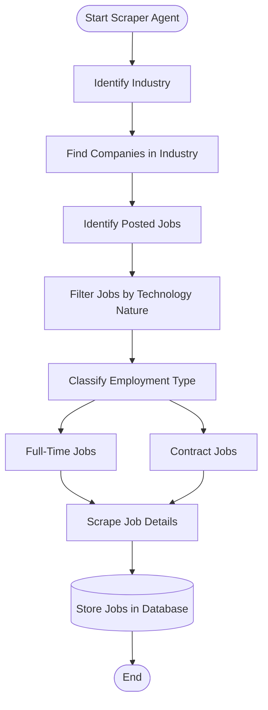

# AutoJobApply – Dynamic Scraper Agent

An intelligent, multi-industry Python job scraper agent designed to **dynamically discover companies and fresh jobs** in real time across industries, without relying on static or hardcoded company lists. It continuously captures postings, enforces a **freshness window (current month & previous month)**, filters roles by technology nature, classifies employment types (`FULL_TIME` vs `CONTRACT`), normalizes location and remote work details, and persists jobs into PostgreSQL with deduplication and change auditing.

---

## 🎯 Architecture & Workflow

The Scraper Agent strictly implements the pipeline defined in the system workflow diagram:



---

## ⚡ Key Highlights

### 1. 🌐 Zero Hardcoding: Direct Career Pages via Playwright Browser Automation
- **No third-party aggregators or ATS APIs**: Directly automates browser sessions using **Playwright** to navigate real corporate career portals (`https://domain/careers` or `https://about.domain/jobs`).
- Extracts job cards, links, and content dynamically rendered by JavaScript, SPAs, and shadow DOMs.

### 2. 🎯 Exact Workflow Implementation
- **Step 1: Start Scraper Agent**: Initializes database connection, Playwright browser, and pipeline.
- **Step 2: Identify Industry**: User picks industry (`Information Technology`, `Healthcare`, `Finance`, `Energy`, `Defense`, `Cybersecurity`, or custom).
- **Step 3: Find Companies in Industry**: Automatically retrieves all companies belonging to that industry along with their real career page URLs.
- **Step 4: Identify Posted Jobs**: Opens the company's real career page via Playwright and extracts all posted job listings.
- **Step 5: Filter Jobs by Technology Nature**: Evaluates job title and description, retaining software and technology roles while filtering out non-tech positions.
- **Step 6: Classify Employment Type**: Branches explicitly into **Full-Time Jobs** and **Contract Jobs**.
- **Step 7: Scrape Job Details**: Deep JD intelligence analysis (deducing Tech Role, Industry Domain, normalizing location & remote type, SHA-256 content hashing, and enforcing current/previous month freshness).
- **Step 8: Store Jobs in Database**: High-speed batch upsert into PostgreSQL (`companies`, `job_sources`, `jobs`, `scrape_runs`).
- **Step 9: End**: Visual execution summary and analytics.

### 3. 🗓 Freshness Date Filter: Current Month & Previous Month
- **Guarantees only fresh listings**: Automatically computes dynamic threshold:
  $$\text{Cutoff Date} = \text{1st day of previous month at 00:00:00 UTC}$$
  *Example*: In November 2026, the cutoff is **2026-10-01**. Postings from October and November 2026 are captured; older stale postings are discarded.

### 3. 🤖 Daily Automated Scraper Mode (`--daily`)
- Supports running continuously as a daily background agent that automatically re-scrapes fresh jobs every 24 hours (or at custom intervals).

---

## 🗄️ Database Architecture & Schema Decisions

### 1. Companies Table
Stores all discovered companies across all industries in a single table with an `industry` classification field:

```sql
CREATE TABLE IF NOT EXISTS companies (
    id BIGSERIAL PRIMARY KEY,
    name VARCHAR(150) NOT NULL UNIQUE,
    domain VARCHAR(255),
    career_url TEXT,
    industry VARCHAR(100),
    active BOOLEAN NOT NULL DEFAULT TRUE,
    created_at TIMESTAMP NOT NULL DEFAULT CURRENT_TIMESTAMP,
    updated_at TIMESTAMP NOT NULL DEFAULT CURRENT_TIMESTAMP
);
```

### 2. Job Sources Table
Tracks dynamically registered endpoints and execution health:

```sql
CREATE TABLE IF NOT EXISTS job_sources (
    id BIGSERIAL PRIMARY KEY,
    company_id BIGINT NOT NULL REFERENCES companies(id) ON DELETE CASCADE,
    source_url TEXT NOT NULL,
    scraper_type VARCHAR(100) NOT NULL,
    active BOOLEAN NOT NULL DEFAULT TRUE,
    last_run_at TIMESTAMP,
    last_success_at TIMESTAMP,
    last_failure_at TIMESTAMP,
    created_at TIMESTAMP NOT NULL DEFAULT CURRENT_TIMESTAMP,
    updated_at TIMESTAMP NOT NULL DEFAULT CURRENT_TIMESTAMP
);
```

### 3. Jobs Table
Stores both `FULL_TIME` and `CONTRACT` jobs in a unified schema:

```sql
CREATE TABLE IF NOT EXISTS jobs (
    id BIGSERIAL PRIMARY KEY,
    company_id BIGINT NOT NULL REFERENCES companies(id) ON DELETE CASCADE,
    source_id BIGINT NOT NULL REFERENCES job_sources(id) ON DELETE CASCADE,
    external_job_id VARCHAR(255),
    title VARCHAR(500) NOT NULL,
    description TEXT,
    location VARCHAR(500),
    city VARCHAR(150),
    state VARCHAR(150),
    country VARCHAR(100),
    remote_type VARCHAR(50),
    employment_type VARCHAR(100),
    posted_at TIMESTAMP,
    source_updated_at TIMESTAMP,
    first_seen_at TIMESTAMP NOT NULL DEFAULT CURRENT_TIMESTAMP,
    last_seen_at TIMESTAMP NOT NULL DEFAULT CURRENT_TIMESTAMP,
    job_url TEXT NOT NULL,
    application_url TEXT,
    content_hash VARCHAR(64),
    status VARCHAR(50) NOT NULL DEFAULT 'OPEN',
    created_at TIMESTAMP NOT NULL DEFAULT CURRENT_TIMESTAMP,
    updated_at TIMESTAMP NOT NULL DEFAULT CURRENT_TIMESTAMP,
    CONSTRAINT uq_company_external_job UNIQUE (company_id, external_job_id)
);
```

### 4. Scrape Runs Table
Auditing and execution metrics for every run:

```sql
CREATE TABLE IF NOT EXISTS scrape_runs (
    id BIGSERIAL PRIMARY KEY,
    source_id BIGINT NOT NULL REFERENCES job_sources(id) ON DELETE CASCADE,
    started_at TIMESTAMP NOT NULL,
    completed_at TIMESTAMP,
    jobs_found INTEGER NOT NULL DEFAULT 0,
    new_jobs INTEGER NOT NULL DEFAULT 0,
    updated_jobs INTEGER NOT NULL DEFAULT 0,
    duplicate_jobs INTEGER NOT NULL DEFAULT 0,
    invalid_jobs INTEGER NOT NULL DEFAULT 0,
    status VARCHAR(50),
    error_message TEXT
);
```

---

## 🚀 Installation & Setup

### 1. Environment Configuration
Configure `.env` in the project root:

```ini
# PostgreSQL Connection
DB_HOST=localhost
DB_PORT=5433
DB_NAME=scraperAgent
DB_USER=postgres
DB_PASSWORD=root

# Scraper Settings
REQUEST_TIMEOUT=20
MAX_RETRIES=3
FILTER_TECH_ONLY=true
LOG_LEVEL=INFO
```

### 2. Install Dependencies
```powershell
pip install -r requirements.txt
```

---

## 💻 Usage & CLI Guide

### 1. View Current Database Statistics
```powershell
python main.py --stats
```

### 2. Run Dynamic Discovery for Any Industry
Discover companies and jobs dynamically without any static company names:
```powershell
# Healthcare
python main.py --industry Healthcare

# Finance
python main.py --industry Finance

# Information Technology
python main.py --industry "Information Technology"

# Energy
python main.py --industry Energy

# Defense
python main.py --industry Defense
```

### 3. Run Daily Scheduled Scraper ("Daily Scraper")
Runs continuously, repeating every 24 hours to automatically ingest fresh postings:
```powershell
python main.py --daily --interval 24
```

### 4. Interactive Mode
```powershell
python main.py --interactive
```
Allows selecting or typing any custom industry domain.

---

## 🧪 Running Tests

```powershell
python -m unittest discover -s tests
```
