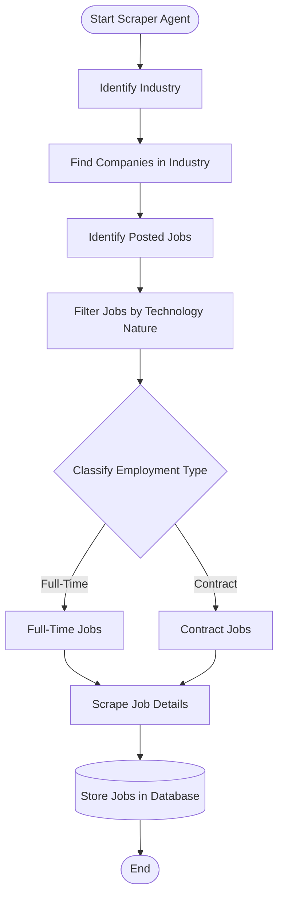

# AutoJobApply – Job Scraper Agent

An intelligent, multi-industry Python job scraper agent designed to discover companies, identify posted jobs across major ATS platforms (Greenhouse, Lever, Ashby, and Generic Career pages), filter roles by technology nature, classify employment type (`FULL_TIME` vs `CONTRACT`), normalize geographic and remote work details, and persist jobs into a local PostgreSQL database with deduplication and change auditing.

---

## 🎯 Architecture & Workflow

The Scraper Agent strictly implements the pipeline defined in the system workflow diagram:



### Pipeline Steps:
1. **Start Scraper Agent**: Initializes session, verifies PostgreSQL database connectivity, and prepares logging.
2. **Identify Industry**: Selects target industry domain (e.g. `Information Technology`, `Finance`, `Healthcare`, `Energy`, `Defense`, or `ALL`).
3. **Find Companies in Industry**: Queries the `companies` table for active companies matching the requested industry.
4. **Identify Posted Jobs**: Dynamically loads the appropriate scraper engine (`Greenhouse`, `Lever`, `Ashby`, or `Generic HTML`) based on `job_sources.scraper_type` to fetch raw postings.
5. **Filter Jobs by Technology Nature**: Analyzes job titles and descriptions with regex rules to distinguish technology roles (Software, AI/ML, Cloud, Data, DevOps, Security, QA, etc.) from non-tech positions.
6. **Classify Employment Type**: Analyzes job commitments, title tags, and descriptions to classify postings into `FULL_TIME` or `CONTRACT`.
7. **Scrape Job Details**: Extracts clean descriptions (stripping HTML), parses locations into `city`, `state`, `country`, determines `remote_type` (`REMOTE`, `HYBRID`, `ON_SITE`), and computes a deterministic SHA-256 `content_hash`.
8. **Store Jobs in Database**:
   - Inserts fresh postings as `NEW`.
   - Compares SHA-256 `content_hash` for existing jobs: updates details if modified (`UPDATED`) or refreshes `last_seen_at` if unchanged (`DUPLICATE`).
   - Records execution metrics in `scrape_runs` and updates `job_sources` timestamps (`last_run_at`, `last_success_at`, `last_failure_at`).
9. **End**: Generates a Rich formatted execution summary and dashboard report.

---

## 🗄️ Database Architecture & Schema Decisions

### 1. Companies Table
Per the architecture decision, a single unified `companies` table stores organizations across all industries. An `industry` column classifies each company (`Information Technology`, `Healthcare`, `Finance`, `Energy`, `Defense`, etc.):

```sql
CREATE TABLE IF NOT EXISTS companies (
    id BIGSERIAL PRIMARY KEY,
    name VARCHAR(150) NOT NULL UNIQUE,
    domain VARCHAR(255),
    career_url TEXT,
    industry VARCHAR(100),
    active BOOLEAN NOT NULL DEFAULT TRUE,
    created_at TIMESTAMP NOT NULL DEFAULT CURRENT_TIMESTAMP,
    updated_at TIMESTAMP NOT NULL DEFAULT CURRENT_TIMESTAMP
);
```

### 2. Job Sources Table
Tracks the ATS endpoints, scraper type, and operational run health:

```sql
CREATE TABLE IF NOT EXISTS job_sources (
    id BIGSERIAL PRIMARY KEY,
    company_id BIGINT NOT NULL REFERENCES companies(id) ON DELETE CASCADE,
    source_url TEXT NOT NULL,
    scraper_type VARCHAR(100) NOT NULL,
    active BOOLEAN NOT NULL DEFAULT TRUE,
    last_run_at TIMESTAMP,
    last_success_at TIMESTAMP,
    last_failure_at TIMESTAMP,
    created_at TIMESTAMP NOT NULL DEFAULT CURRENT_TIMESTAMP,
    updated_at TIMESTAMP NOT NULL DEFAULT CURRENT_TIMESTAMP
);
```

### 3. Jobs Table
Stores both `FULL_TIME` and `CONTRACT` jobs in a unified schema. Deduplication and updates are enforced via the composite constraint `uq_company_external_job (company_id, external_job_id)`:

```sql
CREATE TABLE IF NOT EXISTS jobs (
    id BIGSERIAL PRIMARY KEY,
    company_id BIGINT NOT NULL REFERENCES companies(id) ON DELETE CASCADE,
    source_id BIGINT NOT NULL REFERENCES job_sources(id) ON DELETE CASCADE,
    external_job_id VARCHAR(255),
    title VARCHAR(500) NOT NULL,
    description TEXT,
    location VARCHAR(500),
    city VARCHAR(150),
    state VARCHAR(150),
    country VARCHAR(100),
    remote_type VARCHAR(50),
    employment_type VARCHAR(100),
    posted_at TIMESTAMP,
    source_updated_at TIMESTAMP,
    first_seen_at TIMESTAMP NOT NULL DEFAULT CURRENT_TIMESTAMP,
    last_seen_at TIMESTAMP NOT NULL DEFAULT CURRENT_TIMESTAMP,
    job_url TEXT NOT NULL,
    application_url TEXT,
    content_hash VARCHAR(64),
    status VARCHAR(50) NOT NULL DEFAULT 'OPEN',
    created_at TIMESTAMP NOT NULL DEFAULT CURRENT_TIMESTAMP,
    updated_at TIMESTAMP NOT NULL DEFAULT CURRENT_TIMESTAMP,
    CONSTRAINT uq_company_external_job UNIQUE (company_id, external_job_id)
);

CREATE INDEX IF NOT EXISTS idx_jobs_company ON jobs(company_id);
CREATE INDEX IF NOT EXISTS idx_jobs_source ON jobs(source_id);
CREATE INDEX IF NOT EXISTS idx_jobs_status ON jobs(status);
CREATE INDEX IF NOT EXISTS idx_jobs_posted_at ON jobs(posted_at DESC);
CREATE INDEX IF NOT EXISTS idx_jobs_first_seen ON jobs(first_seen_at DESC);
```

### 4. Scrape Runs Table
Tracks auditing and operational telemetry for every scrape iteration:

```sql
CREATE TABLE IF NOT EXISTS scrape_runs (
    id BIGSERIAL PRIMARY KEY,
    source_id BIGINT NOT NULL REFERENCES job_sources(id) ON DELETE CASCADE,
    started_at TIMESTAMP NOT NULL,
    completed_at TIMESTAMP,
    jobs_found INTEGER NOT NULL DEFAULT 0,
    new_jobs INTEGER NOT NULL DEFAULT 0,
    updated_jobs INTEGER NOT NULL DEFAULT 0,
    duplicate_jobs INTEGER NOT NULL DEFAULT 0,
    invalid_jobs INTEGER NOT NULL DEFAULT 0,
    status VARCHAR(50),
    error_message TEXT
);

CREATE INDEX IF NOT EXISTS idx_scrape_runs_source_started ON scrape_runs(source_id, started_at DESC);
```

---

## 🚀 Installation & Setup

### Prerequisites
- Python 3.10+ (tested on Python 3.14)
- PostgreSQL (database `scraperAgent` running locally)

### 1. Environment Configuration
Create or configure your `.env` file in the project root:

```ini
# PostgreSQL Connection
DB_HOST=localhost
DB_PORT=5433
DB_NAME=scraperAgent
DB_USER=postgres
DB_PASSWORD=root

# Scraper Settings
REQUEST_TIMEOUT=20
MAX_RETRIES=3
FILTER_TECH_ONLY=true
LOG_LEVEL=INFO
```

### 2. Install Dependencies
```powershell
# Create and activate virtual environment
python -m venv .venv
.\.venv\Scripts\Activate.ps1

# Install requirements
pip install -r requirements.txt
```

### 3. Initialize & Seed Database
Run the initialization flag to apply the DDL schema and seed companies across industries:
```powershell
python main.py --init-db
```

---

## 💻 Usage & CLI Guide

### 1. View Current Database Statistics
```powershell
python main.py --stats
```
Displays high-level counts, jobs by industry, employment type (`FULL_TIME` vs `CONTRACT`), and remote work distribution (`REMOTE`, `HYBRID`, `ON_SITE`).

### 2. Scrape Jobs for a Specific Industry
```powershell
# Information Technology (GitLab, Figma, Datadog, Elastic, Linear, Synthesia)
python main.py --industry "Information Technology"

# Healthcare (Oscar Health, Doximity, Komodo Health)
python main.py --industry Healthcare

# Finance (Coinbase, Robinhood, Ramp, Wealthfront)
python main.py --industry Finance

# Energy (ChargePoint, Palmetto)
python main.py --industry Energy

# Defense (Anduril Industries)
python main.py --industry Defense
```

### 3. Scrape Jobs for a Specific Company
```powershell
python main.py --company GitLab
python main.py --company Figma
python main.py --company Ramp
```

### 4. Interactive Mode
Launch an interactive CLI menu to select your target industry:
```powershell
python main.py --interactive
```

### 5. Disable Tech Filtering (Scrape All Jobs)
To capture non-technology positions (sales, marketing, legal, operations):
```powershell
python main.py --industry Healthcare --all-jobs
```

---

## 🧪 Running Tests

The test suite includes both unit tests (classifier logic, scrapers, deduplication hashing) and integration tests (PostgreSQL upsert lifecycle):

```powershell
# Run all unit and integration tests
python -m unittest discover -s tests
```

---

## 📁 Project Structure

```
d:\Job_Scraper_Python\
├── .env.example              # Environment variables template
├── .env                      # Local environment configuration
├── requirements.txt          # Python dependencies
├── README.md                 # Project documentation
├── main.py                   # Application entry point
├── sql/
│   ├── schema.sql            # PostgreSQL DDL schema & indexes
│   └── seed_data.sql         # Seed companies & ATS job sources
├── scraper_agent/
│   ├── __init__.py
│   ├── config.py             # Database and scraper configuration
│   ├── cli.py                # Command-line interface & formatting
│   ├── models/
│   │   ├── __init__.py
│   │   └── job.py            # Dataclasses (Company, JobSource, ProcessedJob, ScrapeRunStats)
│   ├── db/
│   │   ├── __init__.py
│   │   ├── connection.py     # Database connection pool & context managers
│   │   ├── schema_manager.py # Schema application & migrations
│   │   └── repository.py     # Batch upsert, deduplication & query operations
│   ├── classifiers/
│   │   ├── __init__.py
│   │   ├── tech_filter.py    # Tech nature filtering (software, AI/ML, cloud, data, etc.)
│   │   ├── employment.py     # Employment type classifier (FULL_TIME vs CONTRACT)
│   │   └── location_parser.py# Geographic and remote_type normalization
│   ├── scrapers/
│   │   ├── __init__.py
│   │   ├── base.py           # Abstract BaseScraper, HTML cleaner & SHA-256 hash
│   │   ├── greenhouse.py     # Greenhouse ATS API integration
│   │   ├── lever.py          # Lever ATS API integration
│   │   ├── ashby.py          # Ashby ATS API integration
│   │   ├── generic_html.py   # BeautifulSoup HTML scraper
│   │   └── registry.py       # Scraper factory & registry
│   └── agent/
│       ├── __init__.py
│       └── scraper_agent.py  # Pipeline orchestrator executing the flowchart
└── tests/
    ├── test_classifiers.py   # Unit tests for filter and classifiers
    ├── test_scrapers.py      # Unit tests for scrapers & content hash
    └── test_integration.py   # Integration tests with PostgreSQL
```
